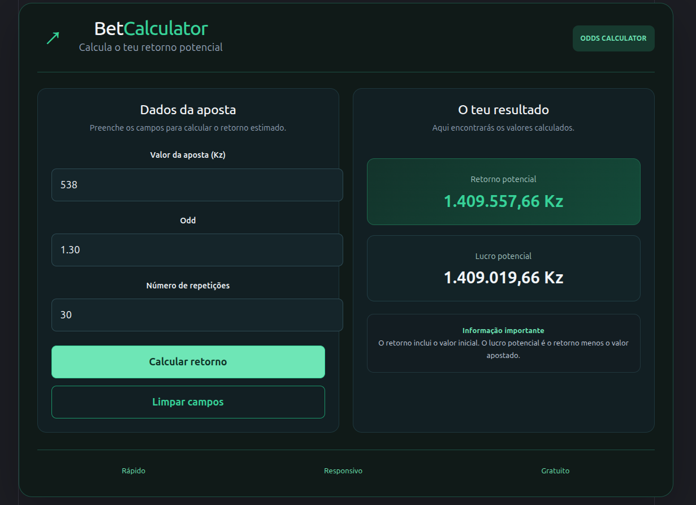

# 💚 BetCalculator

A modern, responsive betting return calculator built with **React, TypeScript, and Vite**.

BetCalculator helps users estimate potential returns and potential profit based on an initial stake, decimal odds, and a number of repetitions.



## ✨ Features

- 💰 **Stake Calculator** — enter the initial amount in Angolan Kwanza (Kz).
- 📊 **Odds Input** — specify the decimal odds.
- 🔁 **Repetition Control** — choose how many times the odds are applied.
- 🧮 **Potential Return** — calculate the estimated total return.
- 💵 **Potential Profit** — estimate the return minus the initial stake.
- ✅ **Input Validation** — handle invalid values and excessively large results.
- 🌙 **Modern Interface** — dark theme with green accents.
- 📱 **Responsive Design** — adapts to desktop and mobile screens.
- 📈 **Vercel Analytics** — support for application usage analytics.

## 🛠️ Built With

- [React](https://react.dev/) — user interface library
- [TypeScript](https://www.typescriptlang.org/) — static typing
- [Vite](https://vite.dev/) — development server and build tool
- CSS — styling and responsive layout
- [Vercel](https://vercel.com/) — deployment and hosting

## 🧮 How It Works

The calculator uses the following formula:

**Potential Return**

`Stake × Odds^Repetitions`

**Potential Profit**

`Potential Return − Stake`

### Example

| Input | Value |
|---|---:|
| Initial stake | 1,000 Kz |
| Decimal odds | 2.5 |
| Repetitions | 3 |
| Potential return | 15,625 Kz |
| Potential profit | 14,625 Kz |

These figures are mathematical estimates based on the inputs provided.

## 🚀 Getting Started

### Prerequisites

Make sure you have installed:

- [Node.js](https://nodejs.org/)
- npm, which is included with Node.js
- Git

### Installation

1. Clone the repository:

   ```bash
   git clone https://github.com/ado-dc/bet-calculator.git
   ```

2. Navigate to the project directory:

   ```bash
   cd bet-calculator
   ```

3. Install dependencies:

   ```bash
   npm install
   ```

4. Start the development server:

   ```bash
   npm run dev
   ```

5. Open the local URL displayed in your terminal.

### Production Build

To build the application for production:

```bash
npm run build
```

To preview the production build locally:

```bash
npm run preview
```

## 📁 Project Structure

```text
bet-calculator/
├── public/
├── src/
│   ├── App.tsx
│   ├── App.css
│   ├── index.css
│   └── main.tsx
├── index.html
├── package.json
├── tsconfig.json
└── vite.config.ts
```

## 🌐 Live Demo

**Live application:** https://bet-calculator-xi.vercel.app/

## 🎯 Project Goal

This project was created as a practical exercise to develop my skills in React, TypeScript, component-based development, state management, input validation, and responsive web design.

## ⚠️ Disclaimer

BetCalculator provides mathematical estimates only. It does not guarantee winnings or predict the outcome of any sporting event. Actual returns may differ due to applicable fees, taxes, platform rules, or other conditions.

Please use betting services responsibly and comply with applicable laws.

## 👨‍💻 Author

**Your Name**

- GitHub: https://github.com/ado-dc
- Project: BetCalculator

---

*Built with React, TypeScript, and a passion for learning.* 💚